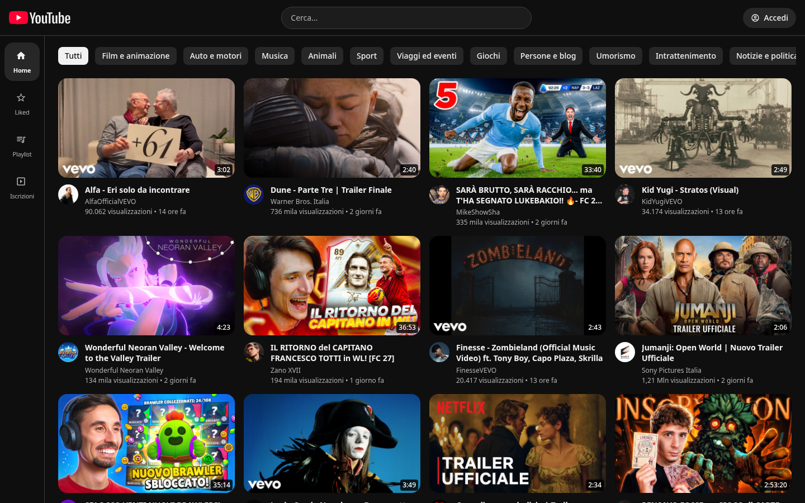

# yt-clone

Un clone dell'interfaccia di YouTube costruito con SvelteKit e la YouTube Data API v3.




---

## Cosa fa

| Pagina                      | Contenuto                                                                                  |
| --------------------------- | ------------------------------------------------------------------------------------------ |
| `/`                         | Feed dei video popolari con chip per categoria e scroll infinito                           |
| `/video/[videoId]`          | Player, dettagli, commenti e video correlati                                               |
| `/search/[searchId]`        | Risultati paginati, filtrabili per tipo (video o canali), ordine, durata e data            |
| `/channel/[channelId]`      | Canale, video (più recenti o più popolari) e scheda informazioni                           |
| `/iscrizioni`               | Iscrizioni dell'utente, con disiscrizione                                                  |
| `/playlist`                 | Le playlist dell'utente                                                                    |
| `/playlist/[playlistId]`    | Video di una playlist, con scroll infinito                                                 |
| `/playlist/liked`           | Video piaciuti, riordinabili con drag and drop                                             |
| `/playlist/watch/[videoId]` | Riproduzione di una playlist (`?list=`, i piaciuti se manca), con coda e avanti e indietro |

Login, like, iscrizioni e commenti passano da OAuth 2.0 e agiscono sul tuo account
YouTube vero: l'app pubblica, modifica ed elimina commenti a tuo nome, e i bottoni
di modifica compaiono solo sui commenti che hai scritto tu. Solo l'ordine della
playlist resta nel browser.

## Avvio locale

Serve Node `>=22.12` (dichiarato in `engines`).

```bash
git clone https://github.com/imalbi/yt-clone.git
cd yt-clone
npm install
cp .env.example .env   # riempi almeno YOUTUBE_API_KEY
npm run dev
```

### Variabili d'ambiente

Una sola è obbligatoria. Le altre tre abilitano le funzioni utente, e senza di
esse l'app resta navigabile in sola lettura invece di rompersi: `/api/auth/login`
risponde 503 con un messaggio, il resto funziona.

| Variabile                  | Obbligatoria | A cosa serve                                 |
| -------------------------- | ------------ | -------------------------------------------- |
| `YOUTUBE_API_KEY`          | sì           | Video, ricerca, canali, commenti             |
| `PUBLIC_YOUTUBE_CLIENT_ID` | no           | OAuth: login, like, iscrizioni               |
| `YOUTUBE_CLIENT_SECRET`    | no           | OAuth                                        |
| `PUBLIC_REDIRECT_URL`      | no           | OAuth, deve combaciare con l'URI autorizzato |

La chiave API viene da [Google Cloud Console](https://console.cloud.google.com/apis/credentials)
dopo aver abilitato "YouTube Data API v3" sul progetto. Le credenziali OAuth sono
una cosa diversa: Credenziali → Crea credenziali → ID client OAuth 2.0 →
Applicazione web, con `http://localhost:5173/api/auth/callback` fra gli URI di
reindirizzamento autorizzati.

`YOUTUBE_API_KEY` sta nel namespace privato di SvelteKit, quindi il build fallisce
se finisce in codice client. Le tre variabili OAuth sono lette a runtime, il che è
ciò che permette di compilare senza.

## Comandi

```bash
npm run dev      # server di sviluppo
npm run build    # build di produzione (adapter Vercel)
npm run check    # svelte-check
npm run lint     # eslint + prettier
npm test         # vitest
```

Un hook pre-commit esegue eslint e prettier sui file in stage.

## Stack

- **SvelteKit 3** (pre-release) con **Svelte 5** in modalità runes e le remote functions sperimentali
- **TypeScript 6**, non la 7, perché `svelte-check` si ferma a `typescript@^6`
- **Tailwind CSS 4**, configurato via CSS
- **Vite 8**, con le icone compilate a build time da `unplugin-icons`
- **TanStack Query 6** per lo stato lato client
- **Zod 4** per validare le risposte dell'API
- **Bits UI** per il drawer di navigazione
- **Vitest** e Testing Library per i test di logica e di componente

## Note di implementazione

**I dati arrivano dal server, non dal browser.** I `load` di SvelteKit producono
il payload SSR. Le liste paginate passano dagli endpoint `/api` e da TanStack
Query, mentre le letture e le scritture dell'utente (like, iscrizioni, commenti)
sono remote functions in `src/lib/youtube.remote.ts`, con una firma sola valida
da entrambe le parti. La chiave API non raggiunge mai il browser e i cookie di
sessione restano `httpOnly`.

**Cache lato server contro la quota.** La Data API concede 10.000 unità al
giorno e una manciata di ricariche le consuma. Le risposte pubbliche stanno in
una cache in memoria con scadenza di cinque minuti: una ricerca ripetuta passa
da ~500 ms a ~5 ms senza consumare quota. È una `Map` di processo, quindi su più
istanze ognuna ha la sua copia; per una coerenza vera servirebbe Redis.

**Validazione al confine.** I JSON di YouTube passano da schemi Zod prima di
diventare tipi dell'app. Gli elementi malformati vengono scartati singolarmente,
perché in un feed di venti video uno rotto non deve far sparire gli altri
diciannove; se cadono tutti, però, non è un elemento difettoso ma lo schema che
non combacia più, e viene segnalato invece di restituire una lista vuota.

**Commenti come testo puro.** L'app chiede `textFormat=plainText` all'API, così
i commenti non contengono mai markup e vengono resi con l'interpolazione normale
di Svelte anziché con `{@html}`. I link li riconosce `linkify`, che accetta solo
indirizzi http e https, e si aprono con `rel="noopener noreferrer nofollow"`.

**Sessione risolta una volta sola.** `hooks.server.ts` rinnova l'access token
quando è scaduto e mette utente e token in `locals`, così nessun endpoint rilegge
i cookie a mano.

## Limiti noti

- I video correlati sono i più popolari del momento, non correlati davvero:
  `search.list` non accetta più `relatedToVideoId`.
- L'ordine della playlist vive in localStorage, quindi non segue l'utente da un
  browser all'altro.
- La cache è per istanza.
- SvelteKit 3, `adapter-vercel` 7 e le remote functions sono in pre-release o
  sperimentali: le versioni sono fissate dal lockfile, ma un aggiornamento può
  rompere l'app.

## Licenza

MIT, vedi [LICENSE](./LICENSE).
